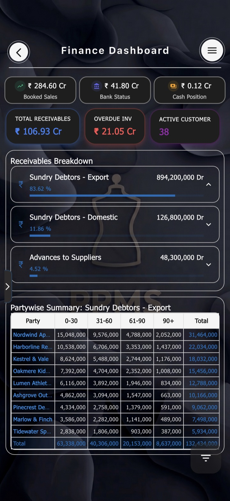
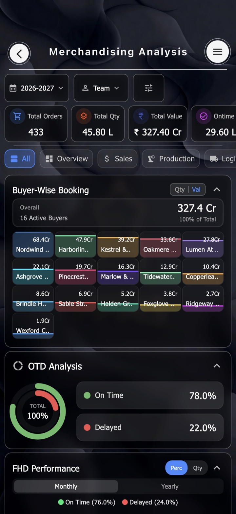
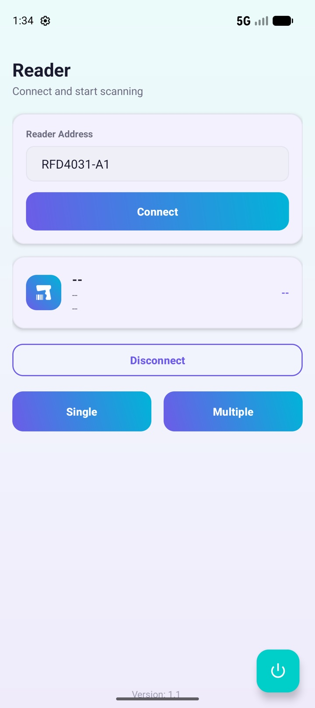
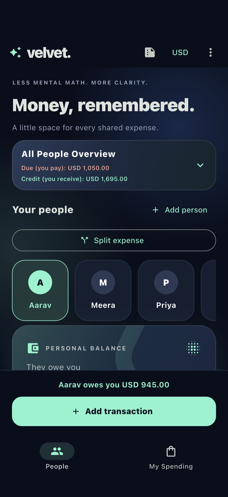

# Saksham Bir Singh: Flutter Developer Portfolio

An interactive portfolio built entirely in **Flutter Web**. You can explore it as a 1995 desktop OS or by walking a character through a hand-painted isometric house.

**[▶ Live site: sakshamsportfolio.web.app](https://sakshamsportfolio.web.app)** · **[Resume (PDF)](https://sakshamsportfolio.web.app/Saksham_Bir_Singh_Resume.pdf)** · **[LinkedIn](https://www.linkedin.com/in/saksham-bir-singh)**

> Flutter developer with 2.5+ years of experience shipping a production ERP for garment manufacturing: analytics dashboards, multi-stage QA audits, RFID inventory, and HR self-service. **Open to new roles and relocation.**

---

## Two ways to explore

| Mode | What it is |
|---|---|
| **Retro OS** (`/retro`) | A 1995-style desktop with draggable windows and a taskbar. Open `PROJECTS.EXE`, `ABOUT_ME.TXT` and `CONTACT.EXE`, a working terminal, a UI lab of custom-painted widgets, and three playable games (Snake, Minesweeper, Memory). |
| **Isometric House** (`/isometric`) | Walk-around 2.5D rooms drawn with `CustomPainter`, no game engine. Each piece of furniture opens a section: the TV opens About, the desk opens Projects, the hall console opens Contact, and the lounge kiosks open Games. The character walks to each one, sits down, and wakes up in bed. Try opening the window. |

Both modes read from one data file (`lib/core/portfolio_data.dart`), so content is written once.

## Featured work

| | | | |
|:-:|:-:|:-:|:-:|
|  |  |  |  |
| **Enterprise Analytics**<br>Finance & budget-vs-actual dashboards | **Merchandising Analytics**<br>Order, buyer & shipment intelligence | **RFID Inventory Engine**<br>Native Android app for Zebra RFD40 | **Velvet Ledger**<br>Offline personal expense tracker |

The live site also covers **Quality & Audit Systems**, **ESS & HR Operations**, **Workforce Welfare** and **Brandforge** (a Django logo studio).

<sub>The company app screenshots were recreated against a mock server with invented data. No real company or employee data is shown.</sub>

## Built with

- **Flutter 3 / Dart 3** for web, with `go_router` handling deep links to each mode
- **CustomPainter** for the isometric renderer, character animation, and every chart and widget in the UI lab
- `video_player`, `url_launcher` and `google_fonts`. That's the full dependency list.
- **Firebase Hosting** with SPA rewrites and no-cache headers on the app shell

```
lib/
├── core/                  # routing, theme, shared portfolio content
└── features/
    ├── experience_selector/   # landing screen: choose a mode
    ├── retro_os/              # desktop, windows, terminal, games, UI lab
    └── isometric_room/        # room models, painter, holo panels
```

## Run locally

```bash
flutter pub get
flutter run -d chrome
```

Deploy:

```bash
flutter build web --release
firebase deploy --only hosting
```

## Contact

**Saksham Bir Singh** · Faridabad, India
[Saksham200111@gmail.com](mailto:Saksham200111@gmail.com) · [LinkedIn](https://www.linkedin.com/in/saksham-bir-singh) · [GitHub](https://github.com/Saksham-07)
